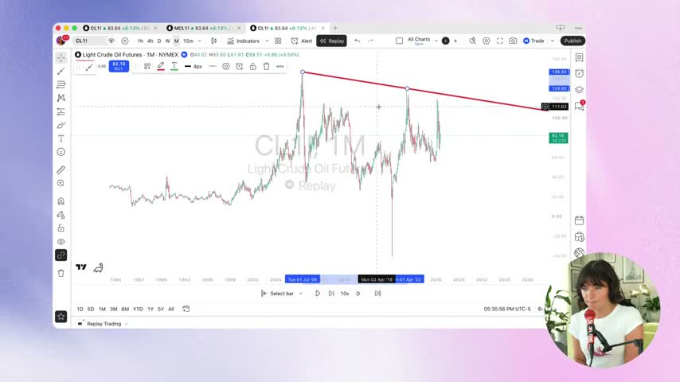
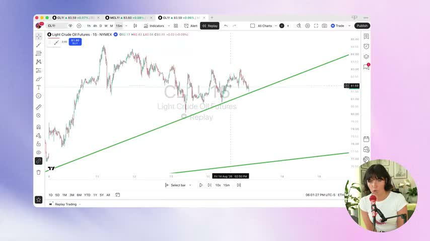
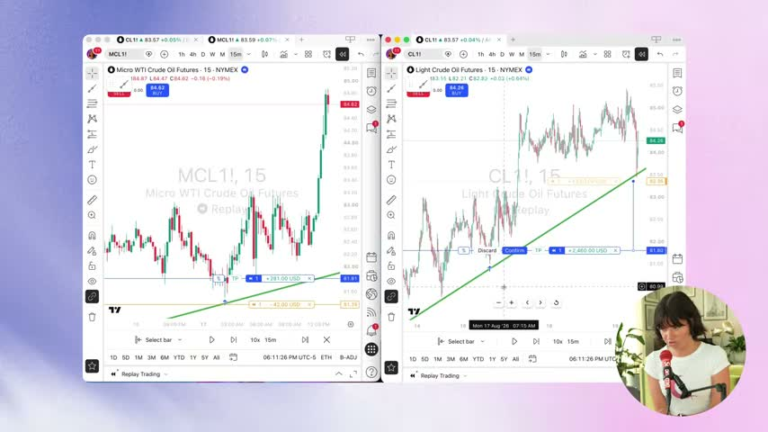
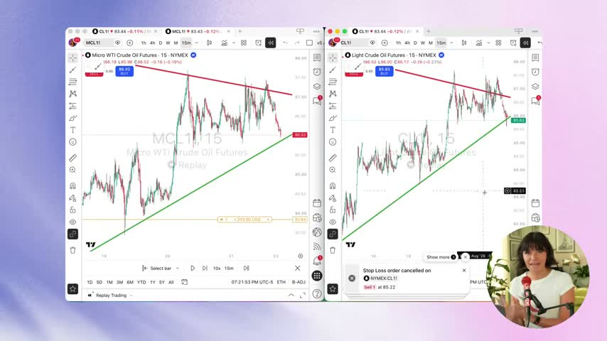

# Trendline bounce (Tori Trades video): backtested, not adopted

- **Date:** 2026-10-10
- **Source:** "Once you master this strategy, trading becomes EASY" by Tori Trades,
  https://youtu.be/TuXOgkcYw9E. Video analysis: `financial_advisor/docs/2026-10-10_tori-trades-trendline-bounce-strategy.md`.
- **Script:** `research/trendline_bounce_experiment.py`
- **Raw output:** `research/results/trendline_bounce_sip_2016_2026.txt`,
  `research/results/trendline_bounce_ibkr_2004_2015.txt`
- **Verdict: REJECTED. Nothing changed in the bot.** The video's exit loses to the
  current exit by a wide margin. The trendline entry has roughly the same edge per
  trade as the ensemble, but it fires about 25 times less often, and more than half its signals
  land on the same bar as an ensemble signal. Adding it to the ensemble changed
  results by noise.

## Question

The video teaches a discretionary futures day-trading method. Draw rising rays
through swing lows. Buy when price comes back to the line and reacts. Put the stop
"just beyond the line", trail it under each new swing low, and exit when a candle
closes through the line. It is supported by one hand-picked replay trade on crude
oil (+$4,000 risked $420, about 9.5R). It gives no win rate and no sample.

Two questions apply to this bot:

1. **Entry:** is a trendline bounce a useful signal on our 4h universe (NVDA, AMZN,
   META, AMD, ARM)?
2. **Exit:** is the video's exit (line stop, swing-low trail, close-through-line
   exit) better than the bracket the bot already uses?

Question 2 was already mostly answered. In September a 3×ATR chandelier trail on the
ensemble's entries lost to the fixed target (`research/exit_style_experiment.py`,
W1–W3). The swing-low trail is a different trail, so it was tested once on its own
entries.

## Method

The video's lines are drawn by eye. That leaves a lot of freedom: which pivot
counts, how much to "adjust", and when a touch is close enough. To test it, I fixed
a mechanical version **before looking at any result**:

| Piece | Rule |
|---|---|
| Swing low | `low[j]` is the strict minimum of `low[j-5 … j+5]`. It is only known at bar `j+5`, so there is no lookahead. |
| Line | Through the two most recent confirmed swing lows `p1 < p2`, with `low[p2] > low[p1]` (a rising line, "trade with the trend"). |
| Rule 1 (no cut) | No 4h **close** below the line from `p1` up to the signal bar. Wicks may poke through. |
| Entry | Signal bar low ≤ line + 0.25×ATR(14), close > line, close > open ("reached the line and reacted"). Fill at the next bar's open, skipped if it drifts more than 1.5% from the signal close (the live slippage guard). |

Variants (3 trials; T3 was added after T1/T2 were seen):

| | Entry | Exit |
|---|---|---|
| **E0** | ensemble (current) | current bracket: 9% stop, TP 2.5×ATR clipped to 4–12%, 6-session breakeven time stop |
| **T1** | trendline | the **video's exit**: initial stop = line − 0.25×ATR. After each new confirmed swing low, raise it to that low − 0.25×ATR. Exit at the next open after a 4h close below the entry line. No target, no time stop. |
| **T2** | trendline | the ensemble's bracket (isolates the entry) |
| **T3** | ensemble + T2 in one book | each one's own exit (is the trendline useful as a seventh signal source?) |

Engine: the legacy 4h engine (fill at the next bar's open). The stop is checked
first on every bar, and a gap through the stop fills at the open. Each year is an
annual $5,000 book with 20% whole-share sizing, 5 slots, realized compounding and a
year-end close. E0 is re-simulated with the same 4h exit simulator
(`exit_style_experiment.simulate`, R0), so all rows are like-for-like. The 4h
simulator is more generous than the production minute engine. Compare the rows
with each other, not with live numbers.

Data: Alpaca SIP 4h for 2016–2026 (the five tickers; ARM from 2023). IBKR 4h for
2004–2015 as an out-of-sample check (NVDA, AMZN and AMD; META and ARM did not
exist yet).

## Results: SIP 2016–2026, $5,000

| Variant | 2016 | 2017 | 2018 | 2019 | 2020 | 2021 | 2022 | 2023 | 2024 | 2025 | 2026 | Compounded | Max DD |
|---|---:|---:|---:|---:|---:|---:|---:|---:|---:|---:|---:|---:|---:|
| **E0 ensemble** | +54.5 | +30.3 | +9.5 | +36.3 | +46.6 | +35.8 | −18.9 | +95.3 | +33.2 | +17.1 | +27.9 | **+1,790%** | 26.7% |
| T1 trendline + video exit | +6.5 | −3.8 | +3.5 | +4.5 | −0.1 | +6.2 | −8.0 | +3.3 | +1.5 | +3.1 | +15.3 | +35% | 10.4% |
| T2 trendline + bracket | +13.3 | −1.6 | +2.0 | +3.4 | +5.1 | +3.1 | +1.3 | +10.9 | +17.2 | +0.2 | +3.4 | +74% | 9.6% |
| T3 ensemble + T2 | +59.4 | +30.6 | +10.9 | +36.4 | +49.7 | +36.1 | −20.1 | +90.3 | +34.6 | +17.1 | +28.0 | +1,869% | 28.1% |

| Variant | Candidates | Trades | Win % | Avg win | Avg loss | Mean/trade | Worst | t (hurdle 2.13) |
|---|---:|---:|---:|---:|---:|---:|---:|---:|
| E0 | 16,688 | 2,113 | 77% | +3.6% | −8.5% | +0.79% | −12.4% | 6.47 |
| T1 | 677 | 393 | 30% | +4.6% | −1.3% | +0.44% | −7.6% | **1.35** |
| T2 | 677 | 376 | 78% | +3.3% | −8.2% | +0.82% | −9.8% | 3.01 |
| T3 | 16,986 | 2,124 | 77% | +3.6% | −8.5% | +0.80% | −12.4% | 6.55 |

T1 exits: 216 stop-loss, 166 line break, 8 gap stop. 379 of 677 trendline signals
(56%) fell on the same 4h bar as an ensemble signal.

## Results: IBKR 2004–2015 (out of sample), $5,000

| Variant | Compounded | Max DD | Trades | Win % | Mean/trade | t (hurdle 2.16) |
|---|---:|---:|---:|---:|---:|---:|
| E0 ensemble | +72.4% | 29.5% | 897 | 65% | +0.35% | 1.70 |
| T1 trendline + video exit | +2.8% | 2.7% | 77 | 23% | +0.21% | **0.30** |
| T2 trendline + bracket | +15.7% | 5.3% | 71 | 76% | +1.06% | 1.89 |
| T3 ensemble + T2 | +74.2% | 29.5% | 902 | 65% | +0.35% | 1.72 |

## Findings

1. **The video's exit does what it promises on the payoff shape, and it doesn't make
   money here.** Losses are tiny (avg −1.3%) and winners larger (+4.6%), but only 30%
   of trades win (23% in 2004–2015). The mean is +0.44% per trade with t = 1.35, which
   fails the hurdle. 2004–2015 is flat (t = 0.30). This matches September's
   trailing-exit result. On these stocks, a 4h line through recent swing lows sits
   inside normal noise, so the tight stop is hit before the bounce pays. The video's
   9.5R crude-oil trade is the right tail of this distribution, not its middle.
2. **The trendline entry is a legitimate dip-buy signal, about as good per trade as
   the ensemble.** With the ensemble's bracket, T2 makes +0.82% per trade (t = 3.01,
   clears the hurdle) and +1.06% in 2004–2015 (t = 1.89, does not). It is the same
   kind of edge the ensemble already captures: buy a pullback in an uptrend, bank the
   bounce.
3. **Its weakness is how rarely it fires.** It produces about 60 signals a year
   against about 1,500 ensemble candidates, so a standalone T2 book sits mostly in cash
   (+74% over 11 years against +1,790%).
4. **Adding it to the ensemble adds nothing you can trust.** More than half its signals are
   already ensemble signals. T3 adds 11 trades in 11 years. The compounded return
   rises from +1,790% to +1,869%, but 2022 and 2023 get worse, max drawdown rises
   from 26.7% to 28.1%, and per-trade stats are unchanged. That is noise, not an
   improvement. The research-loop rule ("both recent years must improve") is not met:
   2025 is identical and 2026 is +0.1 pt.

## Verdict

**REJECTED. Nothing applied.**

- The exit (line stop, swing-low trail, close-through-line) is now the fourth
  trailing/tight exit to lose to the fixed bracket on this bot's dip-buy entries. Do
  not re-propose trailing exits for the bracket strategies. If a trend-style exit is
  ever wanted, it belongs on trend-following entries (`sma_50_cross`,
  `tqqq_momentum`), which already use a signal exit.
- The entry duplicates the ensemble. It could only earn a place as a voter if a
  production-engine test showed a gain, and on this evidence that is not worth a
  trial.

Trials: 3 here. Exit rules have now used 56 trials in total (55 before, plus T1).

**Caveats.** This tests one mechanical reading of a discretionary method. A skilled
human who chooses lines with multi-timeframe context may do better, and that cannot
be backtested honestly. The video trades crude futures on 15-minute bars, while this
test uses large-cap stocks on 4h bars. The legacy 4h engine is more generous than
the production engine. Trades overlap in time across correlated tickers, so the
per-trade t-statistics are optimistic.

## Video frames (for reference)

*Monthly crude: the first ray from the all-time high. Price may not cut through it.*

*Entry: price returns to the steeper 15-minute line and reacts.*

*The stop is moved under a new swing low (T1's trail rule).*

*Exit on a close through the line (T1's `line_break`).*

Other frames: [15-minute after top-down](assets/trendline-bounce/02-15min-after-top-down.jpg),
[micro vs mini risk](assets/trendline-bounce/04-micro-vs-mini-risk.jpg).
